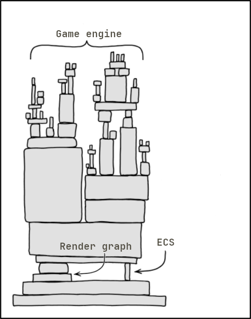

# Game engine? 

Yeah...

- Is a game engine.
- Sucks ass.
- ECS driven.
- Vulkan only.
- Has too many gifs
- No generative "AI" was used.

## How to use

- Probably don't

<!-- See [docs](docs/START_HERE.md) -->


## Features


- ECS (lots of it, the entire architecture is ecs-centric)
- GLSL and Slang Shader compilation and binary management.
- Pipeline and descriptor set management with shader reflection.
  - Automatic descriptor updates.
- GPU ring buffer.
- Vulkan render graph.
- A virtual filesystem
- Probably something else but I forgot the project has a readme.


## Building 


```shell
cd levulkan
cmake -B build
cmake --build build
build/levulkan # profit
```
*You can also set `CPM_USE_LOCAL_PACKAGES=ON` to speed up the process*

### Requirements
- Cmake.
- Build system (e.g. unix makefiles, visual studio, ninja, etc.).
- C++ 20 compiler.
- Glslc / Slangc compiler.
- Validation layers (VK_LAYER_KHRONOS_validation) installed for validation.
- Everything else is managed by cpm.cmake, so no dependency setup is required.

## Cool vulkan resources

- [How to vulkan](https://howtovulkan.com)
- [Vulkan docs](https://docs.vulkan.org)
- [Sasha Willems' vulkan samples](https://github.com/SaschaWillems/Vulkan)
- Rindfleischetikettierungsüberwachungsaufgabenübertragungsgesetz


